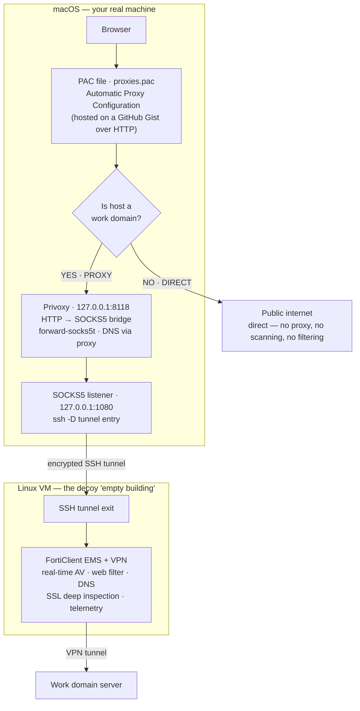

## Fighting back a slow ass EMS

### A Developer's Guide to Taking Your Machine Back

> **Disclaimer:** Only do this if you know what you are doing. This guide assumes you understand networking, system-level tools, and the consequences of modifying proxy configurations. Do not install random software from the internet, do not use this for malicious purposes, and always be aware of your organization's policies. You've been warned.

### The problem

You got a MacBook. Fast, expensive machine. You picked it because things are supposed to *fly* on it.

Then your company says: "Hey, install FortiClient so you can connect to the office VPN." Sure. You just need VPN access to do your work. Sounds simple enough.

Except it's not just a VPN client. It's **Fortinet EMS** — a full endpoint security suite that your company's IT pushes to your machine. It installs itself deep into macOS with kernel-level system extensions. You can't uninstall it. You can't disable it. And suddenly your expensive MacBook feels like it's running through mud.

You didn't sign up for this. You signed up for a VPN.

### What they actually installed on your machine

Let's talk about what FortiClient is *really* doing in the background. Every second. While your Mac is on.

**Real-time antivirus scanning.** This is the big one — the reason your machine feels like it's choking. FortiClient scans every file that gets created, modified, copied, opened, or downloaded. Not after the operation. *Before.* Your machine has to wait for the scan to finish before it can do anything with the file. ([source](https://docs.fortinet.com/document/forticlient/7.4.5/ems-administration-guide/447132/malware-protection))

Think about what that means:

- Opening a Word document? Scanned before Word can even read it.
- Receiving a photo on WhatsApp Desktop? Scanned before it renders.
- Sending a simple chat bubble with an attachment? Scanned.
- Downloading anything from the browser? Held and scanned.
- Streaming a video? The chunks get scanned too.
- Just launching an app? Every binary and library it loads on the way up — scanned.

This is why opening Microsoft Excel feels like you're running it on a [2015 12-inch MacBook](https://www.engadget.com/2019-07-10-farewell-12-inch-macbook.html) — the fanless Core M that Apple shipped and immediately regretted. Your MacBook isn't slow. FortiClient is standing between you and every file on your system, playing bouncer. Users on Fortinet's own community forums [report the same thing](https://community.fortinet.com/t5/Support-Forum/Macbook-Air-FortiClient-Tremendous-Slow/td-p/202452) — tremendous slowdowns on MacBooks.

**FortiSandbox Cloud.** Files that FortiClient can't identify locally? They get uploaded to Fortinet's cloud sandbox. One at a time. Serially. Your download sits in quarantine until the cloud returns a verdict. You're just... waiting. For a file you know is fine. Because a server somewhere hasn't finished deciding yet. ([source](https://docs.fortinet.com/document/forticlient/7.4.5/ems-administration-guide/836582/sandbox))

**Web filtering.** FortiClient installs a network system extension (`com.fortinet.forticlient.macos.proxy`) that intercepts *all* TCP connections. Every DNS query goes through their filtering engine. ([source](https://docs.fortinet.com/document/forticlient/7.4.5/ems-administration-guide/68075/web-filter)) Every HTTPS connection gets certificate inspection. It can even do SSL deep inspection — which is literally a man-in-the-middle decrypting your traffic. Fortinet's own documentation admits this is "highly processor-intensive." Their words, not mine. ([source](https://docs.fortinet.com/document/fortigate/7.6.0/best-practices/598577/ssl-tls-deep-inspection))

**Application firewall.** Another extension (`FortiClientPacketFilter`) inspects every network packet against application signatures. There's even a [documented bug](https://docs.fortinet.com/document/forticlient/7.4.0/macos-release-notes/124818/known-issues) where this thing "decreases internet speed." A bug they shipped. And you're living with it.

**Vulnerability scanning.** Periodic scans that check all your installed software against vulnerability databases. When these kick in, your CPU and disk I/O spike — usually right when you're in the middle of something important. Because of course. ([source](https://docs.fortinet.com/document/forticlient/7.4.5/ems-administration-guide/875011/running-vulnerability-scans-on-endpoints))

**Constant telemetry.** FortiClient phones home to EMS roughly every minute. Network changes, logins, VPN events — all trigger additional check-ins on top of that. Your machine is constantly reporting back like it's on parole. ([source](https://docs.fortinet.com/document/forticlient/7.4.5/ems-administration-guide/103498/zero-trust-tagging-rules))

**Zombie processes.** FortiClient's `ffconfig` component has a [known bug](https://docs.fortinet.com/document/forticlient/7.4.0/macos-release-notes/124818/known-issues) that leaves behind zombie processes. This was present from version 7.4.0 through 7.4.3. Dead processes, hanging around, eating resources. Because why not. And if FortiClient's GUI itself becomes unresponsive? [That's documented too](https://community.fortinet.com/t5/FortiClient/FortiClient-GUI-not-responding-or-very-slow/ta-p/262918).

Here's everything FortiClient installs on your Mac:

| Extension | What it does |
| --- | --- |
| `com.fortinet.forticlient.macos.proxy` | TCP proxy for web filtering |
| `FortiClientNetwork` | Network extension for web filter and app firewall |
| `FortiClientPacketFilter` | Packet-level filtering |
| `FortiTray` | System tray daemon |
| `fctservctl2` | Core service daemon (requires Full Disk Access) |
| `ffconfig` | Configuration component (the zombie process one) |

All running. All the time. On Apple Silicon, where CPU and GPU share unified memory, every byte FortiClient hogs is a byte taken from whatever you're actually trying to do.

All of this — for a VPN.

### Why developers get hit the hardest

If you're a regular user, FortiClient is annoying. If you're a developer, it's a different kind of pain. Development workflows touch thousands of files per minute — installing packages, building containers, compiling code, cloning repos, IDE indexing. FortiClient's real-time scanner intercepts file operations across your system.

Fortinet's own community forums are full of people reporting the same thing — [MacBooks grinding to a halt](https://community.fortinet.com/t5/Support-Forum/Macbook-Air-FortiClient-Tremendous-Slow/td-p/202452), [extremely slow internet](https://community.fortinet.com/t5/Support-Forum/extreme-slow-internet-connection-when-Forticlient-is-active-on/td-p/39551), [unresponsive GUIs](https://community.fortinet.com/t5/FortiClient/FortiClient-GUI-not-responding-or-very-slow/ta-p/262918). These aren't edge cases. This is the product working as designed.

You're a developer with a machine built for speed, and it's being kneecapped by software that treats you like you don't know what a phishing email looks like.

### Fighting back

Look, I get it. Security matters. I understand why companies want endpoint protection. Maybe some dumbass *do* click random ads and install sketchy browser extensions.

But here's the thing: this is my personal laptop. I only installed FortiClient because I need the VPN to access work stuff. That's it. I don't need you scanning every file I open, intercepting my DNS, inspecting my HTTPS traffic, and uploading my downloads to some cloud sandbox which I couldn't verify what's really going on inside that "cloud sandbox".

I know what I'm doing. I literally wrote a disclaimer at the top of this article telling people not to install crap from the internet. That should tell you something about where I stand.

But if you still think "well, this article is just straight forward teach people how to risk my company", that's simply your **comprehension skill issue**, you shouldn't be here at the first place and by all means, just get out of here.

So I started thinking: if FortiClient scans literally *everything* that touches the file system, what if it just... had nothing to scan? What if I put the whole FortiClient thing in a sandboxed environment, where there is practically nothing? Basically, I just need the FortiClient "features" (except VPN for sure) to leave my actual machine alone.

That's the big picture. So, how do we fight back while still having the VPN?

Imagine this: your office says "since you work here, we're assigning security guards to you. They'll follow you everywhere — even home. They check every bag, scan every package, read every letter, and inspect everything you touch before you're allowed to use it."

You can't say no. Company policy.

But here's what you *can* do: you rent an empty building down the street. You put a hologram of yourself inside. You tell the guards: "hey, I live here. Feel free to check everything." And they do — they scan every room, every corner, every drawer. All empty. They're happy. They think they're doing their job.

Meanwhile, you're at your actual home, living your life with no one breathing down your neck. And when you actually need to go to the office for work, you walk through a private hallway from your real home to that empty building, and use the office tunnel from there. The guards see you leaving from "your place" and wave you through. They never knew where you actually live.

In technical terms: FortiClient lives in a Linux machine with its VPN connected — that's the empty building with your hologram. Your Mac is your real home. You route specific work domains through a SOCKS5 proxy on that Linux machine, so only work traffic passes through the guarded tunnel. Everything else on your Mac goes direct — no scanning, no filtering, no interception.

### How the hallway actually works

Now let's look at what's happening under the hood. When you open a work domain in your browser, this is the path it takes:



Your browser connects to `127.0.0.1:8118` — that's Privoxy running locally on your Mac. Privoxy takes that traffic and sends it through the SOCKS5 tunnel to your Linux machine, where FortiClient's VPN is connected. The Linux machine makes the actual request through the VPN tunnel. Your Mac never touches the work domain directly — it just walks through the hallway and lets the guards in the other building handle it.

### Let's build it

You'll need three things:

- A **Linux machine** running a SOCKS5 proxy with FortiClient's VPN connected (port `1080`)
- **Privoxy** on your Mac — a bridge that turns HTTP proxy traffic into SOCKS5
- A **PAC file** — a tiny script that tells your browser which domains take the secret hallway

### Step 1: The SOCKS5 proxy (the hallway)

This is the tunnel between your Mac and the Linux machine. You can set it up with a simple SSH tunnel:

```bash
ssh -D 1080 -q -C -N user@your-linux-machine
```

Or if you already have a SOCKS5 proxy running on the Linux box, just make sure it's on port `1080`.

Make sure it works:

```bash
curl --proxy socks5h://127.0.0.1:1080 https://your-work-domain.com
```

If you get a response, you're in. The `socks5h` means DNS also resolves through the proxy — important, because Fortinet intercepts DNS too. Can't have the guards seeing where you're going.

### Step 2: Privoxy (the translator)

Here's an annoying detail: browsers don't speak SOCKS5 through PAC files. PAC files only understand `PROXY` (HTTP) and `SOCKS` (SOCKS4). So we need something that sits on your Mac, accepts HTTP proxy traffic, and forwards it as SOCKS5. That's Privoxy.

```bash
brew install privoxy
```

Tell it where to send traffic:

```bash
echo 'forward-socks5t / 127.0.0.1:1080 .' >> /opt/homebrew/etc/privoxy/config
```

> **Why** `forward-socks5t` **and not** `forward-socks5`**?** The `t` variant resolves DNS through the SOCKS proxy — same as `socks5h` in curl. Without it, your DNS queries still go through Fortinet, and the guards know exactly which door you're knocking on.

Fire it up:

```bash
brew services start privoxy
```

Test it:

```bash
curl --proxy http://127.0.0.1:8118 https://your-work-domain.com
```

### Step 3: The PAC file (the bouncer list)

The PAC file is the list that decides who takes the hallway and who goes through the front door. Only work domains go through the proxy. Everything else stays direct.

```js
function FindProxyForURL(url, host) {
    if (dnsDomainIs(host, ".your-work-domain.com")) {
        return "PROXY 127.0.0.1:8118";
    }
    return "DIRECT";
}
```

Need more domains? Stack them:

```js
function FindProxyForURL(url, host) {
    if (dnsDomainIs(host, ".your-work-domain.com") ||
        dnsDomainIs(host, ".another-work-domain.com")) {
        return "PROXY 127.0.0.1:8118";
    }
    return "DIRECT";
}
```

### Step 4: Host the PAC file (the gotcha)

Here's something that wasted my time so it doesn't have to waste yours: **macOS browsers don't reliably read PAC files from** `file://` **paths**. You can point System Settings at `file:///Users/you/proxies.pac` and nothing happens. No error. Just... nothing.

The fix: host it over HTTP. A GitHub Gist works perfectly:

1. Create a public Gist with your PAC file content
2. Grab the raw URL

Done. The guards can't block a Gist URL.

### Step 5: Tell macOS to use it

Go to **System Settings → Network → Wi-Fi → Details → Proxies**:

1. Enable **Automatic Proxy Configuration**
2. Paste your Gist raw URL
3. Click **OK**

Or if you prefer terminal:

```bash
networksetup -setautoproxyurl "Wi-Fi" "https://gist.githubusercontent.com/you/abc123/raw/proxies.pac"
```

Open your work domain in the browser. If it loads, welcome home. The guards have no idea.

### What you just got back

FortiClient is gone from your Mac. Completely. Fresh install, clean slate. That means:

- **No more real-time scanning.** Open Word, Excel, WhatsApp — they launch instantly, the way they're supposed to on a MacBook. No one's standing between you and your files anymore.
- **No more app launch lag.** Every binary, every library loads without being interrogated first.
- **No more zombie processes.** No `ffconfig` leaking dead processes into your system.
- **No more telemetry.** Your machine isn't phoning home every minute like it's on parole.
- **No more SSL inspection.** Your HTTPS traffic is yours. `npm install`, `docker pull`, `pip` — they all just work. No certificate pinning failures, no deep inspection overhead.
- **No more daemons.** Six always-running extensions wiped from memory. Your unified memory is yours again.

And you still have VPN access to work. The guards are in their building, scanning an empty room. Your work domains route through the hallway. Everything else goes direct.

**"What if the Linux machine goes down?"** Good question. Since the PAC file only routes work domains through the proxy, everything else returns `DIRECT` — straight from your Mac, no proxy involved. If the VM dies or degrades, only work domains are affected. Your normal browsing, your apps, your internet — completely untouched. The hallway collapses, but your front door still works fine.

### Verdict

I was once a rebel. That part of me is buried deep within my soul and shapes the way I think. Force me to live in this kind of situation, and you'll see that rebel rise from the grave I've dug for it.

Just remember: the guards are still out there. Don't give them a reason to knock on your real door.
